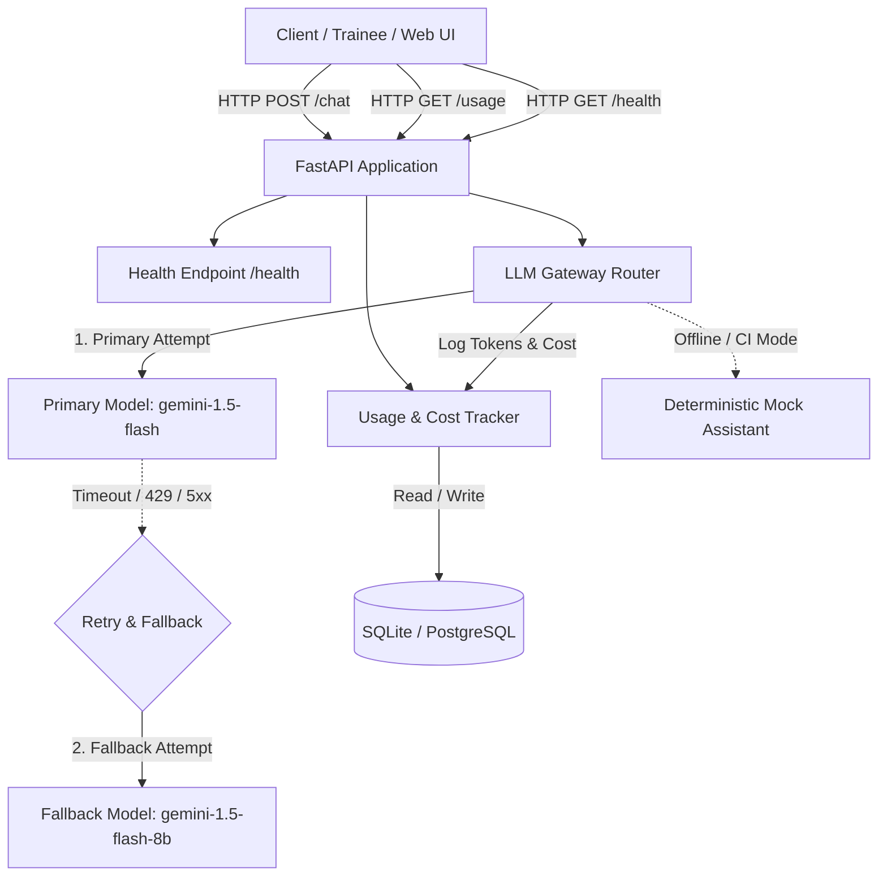
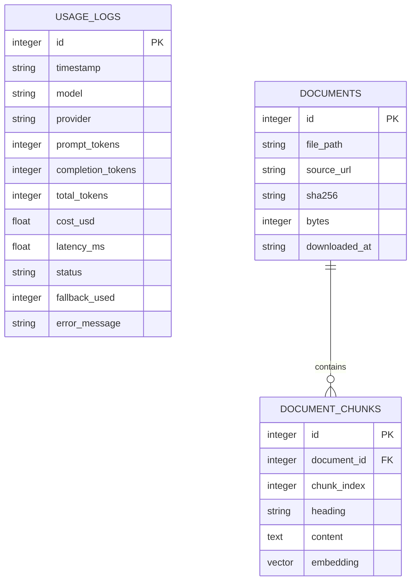
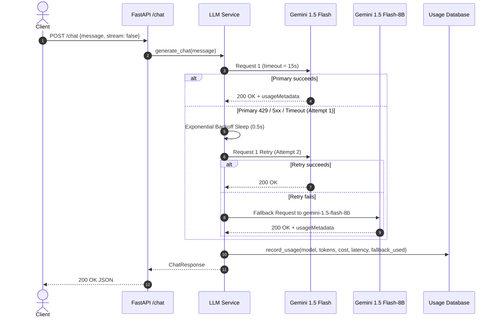

# PodMentor System Design: API Endpoints & Database Tables

## 1. Overview & Objectives

PodMentor is a cost-aware AI assistant designed for SRE trainees and junior DevOps engineers navigating the Kubernetes source code. The core system architecture prioritizes:

1. **Cost-Aware Resilient LLM Routing:** Directing queries to high-efficiency models (`gemini-1.5-flash`), backed by automated retries, timeouts, and an immediate fallback mechanism to resilient secondary models (`gemini-1.5-flash-8b`).
2. **Transparent Consumption Accounting:** Real-time token usage and USD cost tracking recorded per query and queryable via `/usage`.
3. **Dual Delivery Formats:** Standard structured JSON responses alongside real-time streaming via Server-Sent Events (SSE).
4. **Standardized Persistence:** Local zero-configuration SQLite storage seamlessly upgrading to PostgreSQL with `pgvector` in containerized deployments.

---

## 2. High-Level Architecture



---

## 3. API Endpoints Specification

### Endpoints Summary Table

| Method | Path | Summary | Auth | Description |
|---|---|---|---|---|
| `GET` | `/health` | Liveness Probe | None | Fast health check. Verifies process is alive without DB or LLM overhead. |
| `POST` | `/chat` | Code Assistant Chat | None / API Key | Chat completion endpoint supporting structured JSON and SSE streaming. |
| `GET` | `/usage` | Usage & Cost Metrics | None / Admin | Aggregated token totals, cumulative USD cost, and model breakdowns. |
| `DELETE` | `/usage` | Reset Usage History | None / Admin | Administrative endpoint to clear usage logs (primarily for testing). |

---

### 3.1 `GET /health`

Fast, unauthenticated liveness check for container orchestrators (Docker, Kubernetes) and hosting providers (Render, Fly.io).

#### Response Schema

| Field | Type | Description |
|---|---|---|
| `status` | `string` | Always `"ok"` if process is healthy. |
| `app` | `string` | Configured application name (`"podmentor"`). |
| `environment` | `string` | Deployment environment (`"local"`, `"test"`, `"production"`). |

#### Example Response (`200 OK`)

```json
{
  "status": "ok",
  "app": "podmentor",
  "environment": "production"
}
```

---

### 3.2 `POST /chat`

Submits a question to the Kubernetes assistant. Supports synchronous JSON responses and real-time chunk streaming.

#### Request Headers

| Header | Value | Required |
|---|---|---|
| `Content-Type` | `application/json` | Yes |

#### Request Body Schema

| Field | Type | Required | Default | Description |
|---|---|---|---|---|
| `message` | `string` | Yes | — | The question or prompt (e.g. `"Where is pod eviction implemented?"`). |
| `model` | `string` | No | `null` | Optional model override. Defaults to configured `PRIMARY_MODEL`. |
| `stream` | `boolean` | No | `false` | When `true`, streams tokens via Server-Sent Events (`text/event-stream`). |
| `temperature` | `float` | No | `0.2` | Sampling temperature between `0.0` and `2.0`. |
| `max_tokens` | `integer` | No | `2048` | Maximum output generation tokens (`1` to `8192`). |

#### Synchronous Response Schema (`stream: false`)

| Field | Type | Description |
|---|---|---|
| `response` | `string` | The generated answer from the assistant. |
| `model_used` | `string` | Identifier of the model that generated the answer. |
| `fallback_used` | `boolean` | `true` if primary model failed and fallback model served the answer. |
| `tokens.prompt_tokens` | `integer` | Tokens in the user question and system prompt. |
| `tokens.completion_tokens` | `integer` | Tokens generated by the model. |
| `tokens.total_tokens` | `integer` | Sum of prompt and completion tokens. |
| `cost_usd` | `float` | Total estimated cost in USD for this call. |
| `latency_ms` | `float` | Wall-clock latency of the request in milliseconds. |
| `timestamp` | `string` | ISO 8601 UTC timestamp. |

#### Example Request

```json
{
  "message": "Where is the pod eviction code implemented in Kubernetes?",
  "stream": false,
  "temperature": 0.2
}
```

#### Example Synchronous Response (`200 OK`)

```json
{
  "response": "In the Kubernetes source code, pod eviction logic is primarily implemented in `pkg/controller/nodelifecycle/node_lifecycle_controller.go` (node lifecycle controller) and `pkg/kubelet/eviction/` (kubelet resource-based eviction).",
  "model_used": "gemini-1.5-flash",
  "fallback_used": false,
  "tokens": {
    "prompt_tokens": 15,
    "completion_tokens": 48,
    "total_tokens": 63
  },
  "cost_usd": 0.00001553,
  "latency_ms": 342.15,
  "timestamp": "2026-10-30T10:14:00.123456Z"
}
```

#### Streaming Protocol (`stream: true`)

When `stream: true`, the response Content-Type is `text/event-stream`. Intermediate events provide content chunks, and the terminal event provides cost and token accounting:

```http
HTTP/1.1 200 OK
Content-Type: text/event-stream
Cache-Control: no-cache

data: {"chunk": "In the Kubernetes ", "done": false}

data: {"chunk": "source code, pod ", "done": false}

data: {"chunk": "eviction logic is...", "done": false}

data: {"chunk": "", "done": true, "model_used": "gemini-1.5-flash", "fallback_used": false, "tokens": {"prompt_tokens": 15, "completion_tokens": 48, "total_tokens": 63}, "cost_usd": 0.00001553, "latency_ms": 342.15, "timestamp": "2026-10-30T10:14:00.123456Z"}
```

---

### 3.3 `GET /usage`

Returns cumulative and breakdown consumption metrics across all requests handled by PodMentor.

#### Query Parameters

| Parameter | Type | Required | Default | Description |
|---|---|---|---|---|
| `limit` | `integer` | No | `50` | Maximum number of recent request logs to return (`1` to `500`). |

#### Response Schema

| Field | Type | Description |
|---|---|---|
| `total_requests` | `integer` | Total number of recorded LLM calls. |
| `total_prompt_tokens` | `integer` | Cumulative prompt tokens consumed. |
| `total_completion_tokens` | `integer` | Cumulative completion tokens produced. |
| `total_tokens` | `integer` | Total token volume (`prompt + completion`). |
| `total_cost_usd` | `float` | Cumulative expenditure in USD. |
| `by_model` | `object` | Keyed dictionary of per-model statistics (`requests`, `prompt_tokens`, `completion_tokens`, `total_tokens`, `cost_usd`). |
| `recent_requests` | `array` | List of recent log items ordered newest-first. |

#### Example Response (`200 OK`)

```json
{
  "total_requests": 25,
  "total_prompt_tokens": 3200,
  "total_completion_tokens": 6800,
  "total_tokens": 10000,
  "total_cost_usd": 0.00228000,
  "by_model": {
    "gemini-1.5-flash": {
      "requests": 23,
      "prompt_tokens": 3000,
      "completion_tokens": 6400,
      "total_tokens": 9400,
      "cost_usd": 0.00214500
    },
    "gemini-1.5-flash-8b": {
      "requests": 2,
      "prompt_tokens": 200,
      "completion_tokens": 400,
      "total_tokens": 600,
      "cost_usd": 0.00006750
    }
  },
  "recent_requests": [
    {
      "id": 25,
      "timestamp": "2026-10-30T10:14:00.123456Z",
      "model": "gemini-1.5-flash",
      "provider": "gemini",
      "prompt_tokens": 15,
      "completion_tokens": 48,
      "total_tokens": 63,
      "cost_usd": 0.00001553,
      "latency_ms": 342.15,
      "status": "success",
      "fallback_used": false
    }
  ]
}
```

---

## 4. Database Schema & Tables Specification

PodMentor uses SQLite for local zero-dependency testing/CI and PostgreSQL (with the `pgvector` extension) for production container stacks.

### Entity Relationship Diagram



---

### 4.1 Table: `usage_logs`

Stores persistent transaction logs for each LLM invocation.

| Column Name | SQLite Type | Postgres Type | Constraints | Nullable | Description |
|---|---|---|---|---|---|
| `id` | `INTEGER` | `SERIAL` | `PRIMARY KEY` | No | Auto-incrementing transaction ID |
| `timestamp` | `TEXT` | `TIMESTAMPTZ` | Default UTC | No | ISO 8601 UTC timestamp of request |
| `model` | `TEXT` | `VARCHAR(64)` | Indexed | No | Model name (`gemini-1.5-flash`, etc.) |
| `provider` | `TEXT` | `VARCHAR(32)` | — | No | Provider (`gemini`, `mock`) |
| `prompt_tokens` | `INTEGER` | `INTEGER` | `>= 0` | No | Number of input prompt tokens |
| `completion_tokens` | `INTEGER` | `INTEGER` | `>= 0` | No | Number of generated completion tokens |
| `total_tokens` | `INTEGER` | `INTEGER` | `>= 0` | No | Total tokens consumed |
| `cost_usd` | `REAL` | `NUMERIC(12,8)` | `>= 0` | No | Calculated cost in USD |
| `latency_ms` | `REAL` | `REAL` | `>= 0` | No | Request execution time in milliseconds |
| `status` | `TEXT` | `VARCHAR(32)` | — | No | `'success'`, `'fallback'`, `'failed'` |
| `fallback_used` | `INTEGER` | `BOOLEAN` | `DEFAULT 0` | No | Boolean flag indicating fallback usage |
| `error_message` | `TEXT` | `TEXT` | — | Yes | Error detail if call or attempt failed |

#### Table Indexes

| Index Name | Table | Columns | Purpose |
|---|---|---|---|
| `idx_usage_logs_model` | `usage_logs` | `model` | Optimizes per-model GROUP BY queries |
| `idx_usage_logs_timestamp` | `usage_logs` | `timestamp` | Speeds up ordered history pagination |

---

### 4.2 Table: `documents` (Dataset & RAG Source Tracking)

Manages indexed Kubernetes source code files for retrieval.

| Column Name | SQLite Type | Postgres Type | Constraints | Nullable | Description |
|---|---|---|---|---|---|
| `id` | `INTEGER` | `SERIAL` | `PRIMARY KEY` | No | Document identifier |
| `file_path` | `TEXT` | `VARCHAR(512)` | `UNIQUE` | No | Relative repo path (e.g. `pkg/kubelet/kubelet.go`) |
| `source_url` | `TEXT` | `VARCHAR(512)` | — | No | Upstream GitHub file URL |
| `sha256` | `TEXT` | `VARCHAR(64)` | — | No | File SHA256 hash for change detection |
| `bytes` | `INTEGER` | `INTEGER` | `>= 0` | No | Size of source file in bytes |
| `downloaded_at` | `TEXT` | `TIMESTAMPTZ` | Default UTC | No | Ingestion date |

---

### 4.3 Table: `document_chunks` (pgvector Embeddings)

Stores chunked source files with vector embeddings for semantic search in Week 3.

| Column Name | SQLite Type | Postgres Type | Constraints | Nullable | Description |
|---|---|---|---|---|---|
| `id` | `INTEGER` | `SERIAL` | `PRIMARY KEY` | No | Chunk identifier |
| `document_id` | `INTEGER` | `INTEGER` | `REFERENCES documents(id)` | No | Parent source document |
| `chunk_index` | `INTEGER` | `INTEGER` | `>= 0` | No | Ordinal index of chunk within file |
| `heading` | `TEXT` | `VARCHAR(256)` | — | Yes | Enclosing function/struct/package name |
| `content` | `TEXT` | `TEXT` | — | No | Source code text chunk |
| `embedding` | `TEXT` (JSON) | `vector(768)` | — | Yes | Dense vector representation |

---

## 5. Resilient LLM Routing & Fallback Design

### Sequence Diagram



### Resiliency Parameters

- **Request Timeout:** 15.0 seconds per HTTP call (`LLM_TIMEOUT_SECONDS`).
- **Maximum Retries:** 2 retries on transient errors (`LLM_MAX_RETRIES`).
- **Retryable Errors:** HTTP 429 (Rate Limit), 500, 502, 503, 504, connection timeouts.
- **Immediate Failure:** HTTP 400 Bad Request, 401 Unauthorized, 403 Forbidden fail fast without wasted retries.
- **Fallback Trigger:** If primary model fails all retries or times out, the gateway immediately switches to the secondary fallback model.

---

## 6. Token Pricing & Cost Accounting

Calculated per call according to Google Gemini published rate cards:

$$\text{Cost} = \left(\frac{\text{Prompt Tokens}}{1{,}000{,}000} \times \text{Input Rate}\right) + \left(\frac{\text{Completion Tokens}}{1{,}000{,}000} \times \text{Output Rate}\right)$$

### Official Model Pricing Rate Card

| Model | Role | Input Rate / 1M Tokens | Output Rate / 1M Tokens |
|---|---|---|---|
| `gemini-1.5-flash` | Primary Model | **$0.075** | **$0.300** |
| `gemini-1.5-flash-8b` | Fallback Model | **$0.0375** | **$0.150** |
| `gemini-2.0-flash` | Alternative Flash | **$0.075** | **$0.300** |
| `gemini-1.5-pro` | Reasoning Model | **$1.250** | **$5.000** |
